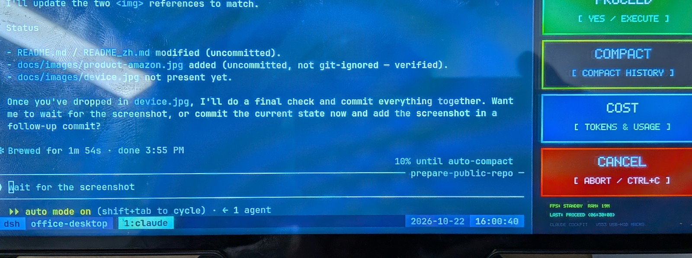

# AI-Agent 物理驾驶舱

[English](README.md) | [简体中文](README_zh.md)

[](https://opensource.org/licenses/MIT)
[-blue.svg)]()
[]()
[]()

> **"拔出 MicroSD：100% 原厂 $40 工厂行车记录仪。插入 MicroSD：专为 vibe-coding 黑客设计的边缘 AI 多模态物理驾驶舱。"**

---

## 1. 项目概述

**AI-Agent 物理驾驶舱** 的前身，是一台 **eBay 上买来的便宜行车记录仪**。

作者在 eBay 上买下一台 10.26" 行车记录仪，惊讶地发现：价格虽然低廉，配置和功能却相当不错。尤其是它那块**带鱼屏（超宽条形屏）**，太适合放在开发者键盘前方、主显示器正下方，作为 **vibe-coding** 的专属副驾。

于是黑客精神发作：拆开外壳、焊上调试串口线，把里面的 **Allwinner V553**（`sun8iw21`，运行 Linux）逆向了出来，最终做成这个开源的、免驱动的 AI 编程物理伴侣（Antigravity CLI / vibe-coding）。这台设备本质上是换标的 **XGODY H26** 类 10.26" 双摄行车记录仪。

<p align="center">
  
</p>

### 黄金法则：100% 无侵入双启动
- **你无需焊接**：唯一的焊接发生在逆向阶段、由作者一次性完成 —— 你永远不用碰烙铁。
- **MicroSD 拔出**：从 16MB SPI NOR Flash 启动未篡改的工厂 Linux 4.9 系统（`cdr` 视频记录器，无线 Apple CarPlay / HiCar）。
- **插入 MicroSD**：Allwinner 芯片 BROM 优先直接从 SDC0（第 16 扇区 eGON 头部）启动我们的定制 AI 驾驶舱操作系统。

---

## 2. 主要特性

- 🖥️ **超宽 10.26" 触摸屏 (1600x600)**：
  - 4 路 MIPI-DSI 高刷新率条形显示屏 (`wtl1026boe2l`)，配备 Goodix GT911 电容式触摸屏。
  - 三区 HUD 布局：实时思维链、活动代码差异 / 计划工件和物理控制触控按钮。
- 🖥️ **免驱 USB 显示器 + 键盘（GUD + HID）**：
  - 通过 USB Type-C 枚举为 **GUD（通用 USB 显示器）**（`0x1d50:0x614d`）+ **USB HID 键盘**（`/dev/hidg0`）复合设备。
  - 主机把它识别为一台原生 1600×600 显示器加一块 USB 键盘 —— **Linux、macOS 和 Windows** 原生支持，无需第三方驱动或主机端流媒体软件。
- 🖲️ **零摩擦物理触控控制**：
  - 屏幕上的大按钮：`🟢 继续`（注入 Enter / `y`），`🛑 停止`（注入 `Ctrl+C`）和 `📋 计划`（注入 `/plan`）。
  - 在工作流程中保持双手无需输入确认信息。
- 👁️ **边缘多模态 AI（路线图 / 已归档）**：
  - **手势引擎（已归档）**：一个基于 V4L2 YCbCr 肤色分割的手势分类器（`firmware/apps/gesture_detector.go`）曾在工厂 Linux 4.9 内核上验证（👌 / ✌️ / ✊ 手势）。由于主线 6.12 内核尚无摄像头（CSI）驱动，它已被**归档** —— 参见 `docs/GESTURE_ENGINE_ARCHIVE*.md`。
  - **双层计算（规划中）**：设备端 Cortex-A7 NEON 推理，或混合流式传输到本地高性能节点。

> **为什么用 GUD + HID 而不是 CDC-NCM：** 早期的 CDC-NCM 虚拟以太网方案将显示器当作视频流来传输，速度远快于 GUD。它被退役是因为：(1) V553 的 USB OTG 控制器仅暴露 **4 个端点**，GUD + HID + NCM 无法共存；(2) NCM 需要主机端软件（`stream_to_monitor.py`、`cockpit.py`）解码视频流 —— 而 GUD + HID 直接以普通显示器和键盘的形式出现，无需任何主机端软件。遗留的 NCM/ADB 脚本保留在 `firmware/boot/setup_gadget.sh` 和 `host-tools/` 中，仅用于调试。

---

## 3. 目录结构

```
├── README.md / README_zh.md      # 项目文档 (EN/ZH)
├── LICENSE                        # MIT 许可证
├── CONTRIBUTING.md / _zh.md       # 贡献指南
├── CHANGELOG.md / _zh.md          # 版本历史
├── .github/workflows/ci.yml       # CI（语法 + shellcheck + 路径/秘密保护）
├── cockpit -> host-tools/cockpit.py
├── docs/                          # 双语工程文档
│   ├── hardware_specs*.md         # 引脚、MIPI 时序、GT911 触摸屏
│   ├── dual_boot_architecture*.md # BROM 启动流程及 SD 布局
│   ├── mainline_linux_roadmap*.md # 主线 Linux 6.x 移植路线图
│   ├── V553_SYSTEM_REFERENCE*.md  # SoC / PMU / SPI NOR / USB 参考
│   ├── V553_MAINLINE_DISPLAY_PORTING_GUIDE*.md
│   ├── MULTIMODAL_COCKPIT_ARCHITECTURE*.md
│   ├── MULTIMODAL_RESEARCH_ROADMAP*.md
│   └── GESTURE_ENGINE_ARCHIVE*.md
├── board/                         # 板子启动（源代码，无供应商树）
│   ├── mainline/                  # Linux 6.12 主线启动
│   │   ├── dts/                   # sun8i-v853-v553-cockpit.dts + dtsi
│   │   ├── config/                # mainline_v853_defconfig
│   │   ├── patches/               # DRM/DE2/TCON/DSI 补丁 + 150 文件系列
│   │   └── scripts/               # switch_to_gud.sh
│   └── buildroot/                 # Buildroot 配置文件 + 现代化补丁
├── firmware/                      # 板载运行时
│   ├── apps/                      # Go/C 守护进程 (gud_v553, touch_cockpit, …)
│   ├── boot/                      # init / USB gadget 脚本
│   ├── config/                    # cockpit_agents.json（代理选择器）
│   └── splash/                    # 启动画面 (splash.png)
├── host-tools/                    # 主机 PC 伴侣工具
│   ├── cockpit.py / *_agent.py    # 统一 CLI + PTY/ADB 桥接
│   ├── stream_to_monitor.py       # 1600x600 显示流式传输器
│   ├── flash_production_sd.sh     # dd 完整 SD 镜像
│   ├── update_kernel_sd.sh        # 更新 SD 上的 zImage/dtb/userspace
│   ├── gud_turbo/                 # GUD turbo 内核模块（仅源代码）
│   └── udev/                      # udev 规则 + 安装脚本
├── factory-reverse/               # 工厂固件逆向工程
│   ├── scripts/                   # UART 截获器，启动嗅探器
│   ├── flasher/                   # flash_tool.go + sunxi-tools 补丁
│   └── dts/                       # 提取的工厂板子.dts
└── scripts/                       # 杂项 UART/dev 辅助工具
    ├── uart_cmd.py
    ├── send_file_serial.py
    ├── reboot_and_capture.py
    └── apply_display_pipeline_fixes.py
```

> **构建工具链和发布镜像有意未提交。**
> Buildroot / 主线内核源代码树、交叉编译器和已编译的二进制文件在构建过程中拉取并通过 GitHub/Gitee 发布 —— 保持 `git clone` 简洁。

---

## 4. 硬件规格

| 组件 | 规格 | 详情 |
| :--- | :--- | :--- |
| **SoC** | Allwinner V553 (`sun8iw21`) | 1x ARM Cortex-A7 @ 900MHz，NEON/VFPv4，E907 RISC-V，1 TOPS NPU |
| **RAM** | 128 MB DDR3 | 集成在 SoC 封装中 |
| **存储** | 16 MB SPI NOR Flash | `XM25QH128C`（工厂固件分区）|
| **MicroSD** | 最高 128 GB | SDC0 接口（BROM 优先启动设备）|
| **显示屏** | 10.26 英寸 IPS 条形屏 | BOE `wtl1026boe2l`，1600x600，4 路 MIPI-DSI，DCLK 53.0MHz |
| **触摸** | 电容多点触控 | Goodix GT911 在 I2C1 上 |
| **摄像头** | MIPI CSI（主线未接线） | 仅在工厂 Linux 4.9 下有 `/dev/video0`；主线 CSI 驱动尚未就绪 |
| **音频** | DMIC（仅驱动） | 已启用 `sound_dmic` ALSA 声卡；暂无麦克风应用 / 无扬声器输出 |
| **USB** | Type-C USB 2.0 OTG | 高速 480Mbps，GUD 显示器 + HID 键盘复合设备 |
| **UART** | 调试串行端口 | PCB 测试点 `tx0`，`rx0`，`GND` @ 115200 8N1 |
| **板子 ID** | `f900x-v2.2` | `km2026240602026.01.03jdh` |

---

## 5. 先决条件

这里的所有内容都针对 **ARMv7 硬浮点** (`arm-linux-gnueabihf`)。

| 要求 | 安装（Ubuntu/Debian） | 使用于 |
| :--- | :--- | :--- |
| ARM 交叉工具链 | `sudo apt install gcc-arm-linux-gnueabihf` | C 应用程序 (`gud_v553`)，内核/模块构建 |
| Go 工具链（≥1.22） | `sudo apt install golang-go` | 固件 Go 应用程序 (`touch_cockpit` 等) |
| Python 3 + 依赖项 | `pip install pyserial numpy pillow` | `host-tools/` 和 `scripts/` |
| `sunxi-fel` | 参见 `factory-reverse/flasher/README.md` | 工厂 SPI Flash 访问 |
| Buildroot | `make v553_cockpit_defconfig && make` | 完整根文件系统（外部 Bootlin 工具链）|

---

## 6. 构建

### 6.1 固件应用程序（设备二进制）

```bash
cd firmware/apps

# Go 应用程序（静态，CGO 禁用）
for app in touch_cockpit gesture_detector send_hid_key fb_receiver v4l2_probe show_splash; do
  GOOS=linux GOARCH=arm GOARM=7 CGO_ENABLED=0 go build -o ../bin/$app $app.go
done

# C 应用程序
arm-linux-gnueabihf-gcc -static -O2 -o ../bin/gud_v553 gud_v553.c
arm-linux-gnueabihf-gcc -static -O2 -o ../bin/gud_test gud_test.c
```

输出位于 `firmware/bin/`（git 忽略）。

### 6.2 GUD turbo 内核模块

```bash
cd host-tools/gud_turbo
make -C /path/to/your/kernel ARCH=arm CROSS_COMPILE=arm-linux-gnueabihf- M=$PWD modules
```

### 6.3 主线 Linux 6.12 内核 + DTB

1. 获取一个 Linux 6.12 主线树。
2. 按顺序应用 `board/mainline/patches/series/*`，然后是 DRM/DE2/TCON/DSI 补丁 `board/mainline/patches/0001-arm-sun8i-v853-v553-Add-full-DRM-DE2-TCON-MIPI-DSI-D.patch`，并添加 `board/mainline/patches/panel-boe-wtl1026boe2l.c`。
3. 使用 `board/mainline/config/mainline_v853_defconfig`。
4. 使用 `make ARCH=arm CROSS_COMPILE=arm-linux-gnueabihf- zImage dtbs` 构建，使用 `board/mainline/dts/` 中的 DTS。

### 6.4 Buildroot 根文件系统

```bash
make -C board/buildroot v553_cockpit_defconfig
make -C board/buildroot
```

使用外部 Bootlin ARMv7 EABI-HF glibc 工具链；参见 `board/buildroot/patches/0001-v553-gcc13-binutils242-modernization.patch`。

---

## 7. 刷写

### 7.1 完整生产 SD 镜像（最快路径）

```bash
host-tools/flash_production_sd.sh   # dd 预构建的 .img 到 /dev/sdX
```

### 7.2 更新现有 SD 卡上的内核 / DTB / 用户空间

```bash
host-tools/update_kernel_sd.sh      # 自动检测 SD 启动分区
```

---

## 8. 主机 PC 使用（GUD 显示器 + HID）

使用 USB Type-C 线缆将设备连接到 PC。在最终（主线 6.12）固件上，设备枚举为
**原生 GUD USB 显示器 + HID 键盘** —— 无需主机端流媒体软件：

- 显示器作为标准显示器出现（Linux 下如 `/dev/dri/card0`，macOS / Windows 下为副屏）。
- Action Bar 通过 HID 键盘接口直接注入按键。

### 8.1 遗留流式传输工具（早期 CDC-NCM / ADB 路线）

以下工具属于早期的 CDC-NCM / ADB 流式传输路线，仅保留用于历史参考和底层调试：

```bash
# 使用高速 30fps 流测试显示输出（遗留 NCM/ADB 路线）
./host-tools/stream_to_monitor.py --test --fps 30

# 将活动的 X11 桌面 / 窗口流式传输到 1600x600 屏幕（遗留路线）
./host-tools/stream_to_monitor.py --display :1.0 --fps 30

# 统一 CLI（双区流 + PTY shell + 触摸注入）
./cockpit --help
```

---

## 9. 许可证及致谢

- **许可证**：[MIT](LICENSE)。
- **致谢**：
  - `linux-sunxi` 社区，为 Allwinner 反向工程开路。
  - András Szemző 和 YuzukiHD 对 `sun8iw21` / V853 上游工作的贡献。
  - Google DeepMind Antigravity 项目。