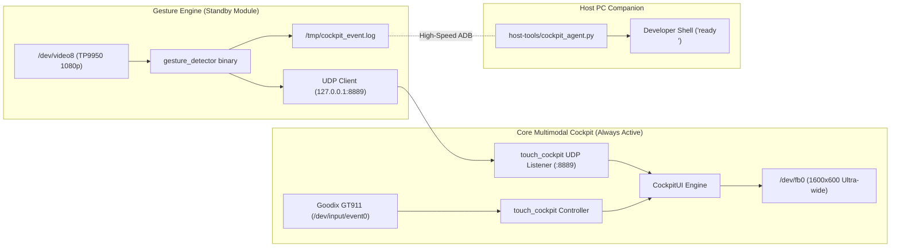

# Visual Gesture Engine — Technical Archival & Re-Integration Specification

> **Language Navigation / 语言导航**:
> - **English Version**: [GESTURE_ENGINE_ARCHIVE.md](GESTURE_ENGINE_ARCHIVE.md)
> - **中文版本**: [GESTURE_ENGINE_ARCHIVE_zh.md](GESTURE_ENGINE_ARCHIVE_zh.md)

---

## 1. Executive Summary & Archival Context

This specification documents the architecture, V4L2 kernel driver parameters, memory alignments, and inter-process signaling protocols for the computer-vision gesture recognition subsystem on the Allwinner V553 (`sun8iw21`) dashcam platform (`f900x-v2.2 km2026240602026.01.03jdh`).

The gesture engine has been **cleanly decoupled** from the primary cockpit runtime into a standby feature-flagged module, ensuring zero performance interference with the primary capacitive touch Action Bar and display streaming pipeline, while maintaining 100% plug-and-play re-integrability for future deep learning / NPU vision upgrades.

---

## 2. Hardware Endpoints & Driver Specifications

### A. Dual Camera Sensor Architecture
The device tree (`/proc/device-tree/soc@03000000/vind@0/`) configures two camera sensors:
1. **Sensor 0 (`sensor@0`)**: `p1_mipi` forward-facing windshield camera mapped to `/dev/video0` (1280x720 NV12 @ 30fps).
2. **Sensor 1 (`sensor@1`)**: `tp9950` / `tp9951` (Techpoint HD video receiver, chip ID `0x6028`) user-facing cabin/rear camera mapped to `/dev/video8`.

### B. V4L2 Multi-Planar (`sunxi-vin`) Driver Contract
The Allwinner Linux 4.9.191 camera subsystem enforces strict multi-planar constraints:
- **Buffer Type**: Must specify `V4L2_BUF_TYPE_VIDEO_CAPTURE_MPLANE` (value `9`). Single-planar capture (`type = 1`) returns `EINVAL` (`22`).
- **32-bit ARM Ioctl Request Codes**:
  - `VIDIOC_QUERYCAP`: `0x80685600`
  - `VIDIOC_G_FMT`: `0xc0cc5604` (sizeof `v4l2_format` is 204 bytes)
  - `VIDIOC_S_FMT`: `0xc0cc5605`
  - `VIDIOC_REQBUFS`: `0xc0145608`
  - `VIDIOC_QUERYBUF`: `0xc0445609`
  - `VIDIOC_QBUF`: `0xc044560f`
  - `VIDIOC_DQBUF`: `0xc0445611`
  - `VIDIOC_STREAMON`: `0x40045612`
  - `VIDIOC_STREAMOFF`: `0x40045613`
  - `VIDIOC_S_INPUT`: `0xc0045627`
- **Resolution & DMA Alignment**:
  - Format: `V4L2_PIX_FMT_NV12` (`0x3231564E`).
  - Native Resolution: 1920x1080.
  - Aligned Buffer Height: **1088 lines** (16-pixel hardware boundary alignment).
  - Single Buffer Length: $1920 \times 1088 \times 1.5 = \mathbf{3,133,440\text{ bytes}}$.
- **Hardware Buffer Queue Constraint**:
  - Driver enforces `req.count = 3` buffers minimum.
  - **Critical Rule**: All 3 buffers MUST be mapped (`mmap`) and queued (`VIDIOC_QBUF`) **BEFORE** calling `VIDIOC_STREAMON`. Omitting queueing results in driver stream freeze.

---

## 3. Inter-Process Signaling Architecture



### Visual Feedback Protocol (UDP `:8889`)
`touch_cockpit` exposes an asynchronous UDP endpoint on `127.0.0.1:8889`:
- Payload `"ready"`:
  - Draws a 24px wide glowing Emerald Green border (`ColorGreen`, `0x07E0`) around all four edges (`1600x600`).
  - Highlights Action Bar Button 1 (`[PROCEED / READY]`) in brilliant white with green outline.
  - Calls `FBIOPAN_DISPLAY`, holds for 300ms, and cleanly restores background.
- Payload `"ctrl+c"`:
  - Draws a 24px wide glowing Crimson Red border (`ColorRed`, `0xF800`) around all four edges.
  - Highlights Action Bar Button 2 (`[STOP / ABORT]`) in brilliant white with red outline for 300ms.

---

## 4. Source Files & Binaries Map

| Path | Purpose / Description |
| :--- | :--- |
| [`firmware/apps/gesture_detector.go`](../firmware/apps/gesture_detector.go) | Complete Go source: V4L2 MPLANE streaming, YCbCr skin filter, contour analysis, and UDP signaling. |
| [`firmware/apps/v4l2_probe.go`](../firmware/apps/v4l2_probe.go) | Standalone V4L2 diagnostic tool for enumerating formats and verifying frame grabs on `/dev/video*`. |
| `firmware/bin/gesture_detector` | Pre-compiled ARMv7-A static binary ready for deployment to `/mnt/sdcard/`. |
| [`firmware/boot/init_usb_monitor.sh`](../firmware/boot/init_usb_monitor.sh) | Dual-boot supervisor script managing feature-flagged daemon startup. |

---

## 5. Instant Re-Integration Guide

### Option 1: Persistent Feature Flag Toggle
To enable gesture detection automatically across cold boots:
```bash
# On the Allwinner V553 device (via ADB):
touch /mnt/sdcard/enable_gesture
reboot
```
To disable again:
```bash
rm -f /mnt/sdcard/enable_gesture
killall -9 gesture_detector
```

### Option 2: On-Demand Manual Launch
To run the gesture engine interactively for testing or diagnostics:
```bash
adb shell "/usr/bin/setsid /mnt/sdcard/gesture_detector </dev/null >/tmp/gesture.log 2>&1 &"
adb shell "cat /tmp/gesture.log"
```

### Option 3: Future NPU / ONNX Model Integration
To replace heuristic skin contouring with a deep neural network (e.g., MediaPipe Hands via NPU):
1. Capture frames using the proven V4L2 MPLANE routine in `firmware/apps/gesture_detector.go`.
2. Feed downsampled tensor to the V553 NPU driver (`/dev/npu` or Rockchip/Allwinner NNA API).
3. Emit results by simply sending `"ready"` or `"ctrl+c"` to UDP `127.0.0.1:8889` and appending to `/tmp/cockpit_event.log`.
