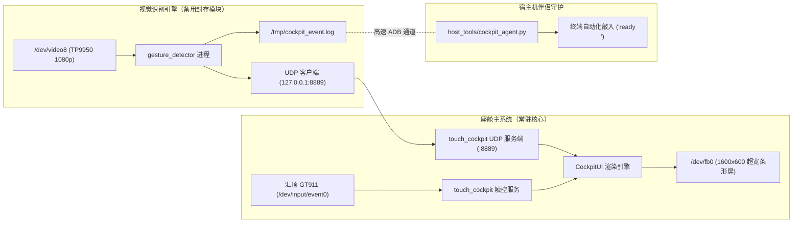

# 视觉手势识别引擎 — 技术归档与即插即用复用规范

> **Language Navigation / 语言导航**:
> - **English Version**: [GESTURE_ENGINE_ARCHIVE.md](file:///home/wchen/nas_home/shares/workspace/allwinner/docs/GESTURE_ENGINE_ARCHIVE.md)
> - **中文版本**: [GESTURE_ENGINE_ARCHIVE_zh.md](file:///home/wchen/nas_home/shares/workspace/allwinner/docs/GESTURE_ENGINE_ARCHIVE_zh.md)

---

## 1. 概述与封存背景

本文档系统记录全志 V553（`sun8iw21`）行车记录仪硬件平台（板本号 `f900x-v2.2 km2026240602026.01.03jdh`）上计算机视觉手势识别子系统的驱动参数、内存对齐规范与跨进程通信协议。

为了确保座舱系统整体交付时效与核心体验，视觉手势引擎已**与主系统彻底解耦并以特征开关（Feature Flag）模式封存**。该设计保证了电容触控操作栏（Action Bar）与显存投屏管线不受任何额外计算开销干扰，同时为未来通过 NPU / 深度学习模型（如 MediaPipe Hands）的无缝热插拔重启提供标准接口。

---

## 2. 硬件端点与驱动接口规范

### A. 双摄像头传感器拓扑
设备树（`/proc/device-tree/soc@03000000/vind@0/`）注册了两个视频节点：
1. **Sensor 0 (`sensor@0`)**：`p1_mipi` 前向挡风玻璃摄像头，映射为 `/dev/video0`（1280x720 NV12 @ 30fps）。
2. **Sensor 1 (`sensor@1`)**：`tp9950` / `tp9951`（Techpoint 高清视频接收芯片，ID `0x6028`）座舱/后视副摄像头，映射为 `/dev/video8`。

### B. V4L2 多平面（`sunxi-vin`）驱动契约
全志 Linux 4.9.191 内核的摄像头驱动具有严格的多平面约束：
- **缓冲类型**：强制要求指定为 `V4L2_BUF_TYPE_VIDEO_CAPTURE_MPLANE`（数值 `9`）。若使用单平面 `type = 1` 会直接返回 `EINVAL`（错误码 `22`）。
- **32 位 ARM Ioctl 控制字**：
  - `VIDIOC_QUERYCAP`: `0x80685600`
  - `VIDIOC_G_FMT`: `0xc0cc5604`（`v4l2_format` 结构体长度固定为 204 字节）
  - `VIDIOC_S_FMT`: `0xc0cc5605`
  - `VIDIOC_REQBUFS`: `0xc0145608`
  - `VIDIOC_QUERYBUF`: `0xc0445609`
  - `VIDIOC_QBUF`: `0xc044560f`
  - `VIDIOC_DQBUF`: `0xc0445611`
  - `VIDIOC_STREAMON`: `0x40045612`
  - `VIDIOC_STREAMOFF`: `0x40045613`
  - `VIDIOC_S_INPUT`: `0xc0045627`
- **分辨率与 DMA 内存对齐**：
  - 格式：`V4L2_PIX_FMT_NV12`（FourCC `0x3231564E`）。
  - 原生分辨率：1920x1080。
  - 对齐高度：**1088 行**（硬件 16 字节对齐）。
  - 单缓冲长度：$1920 \times 1088 \times 1.5 = \mathbf{3,133,440\text{ 字节}}$。
- **DMA 缓冲队列铁律**：
  - 驱动强制要求请求 3 个缓冲区（`req.count = 3`）。
  - **关键铁律**：所有 3 个缓冲区必须在调用 `VIDIOC_STREAMON` 开流**之前**全部完成内存映射（`mmap`）并入队（`VIDIOC_QBUF`），否则驱动会报错 `[VIN_ERR]buffer count is invalid` 并发生数据死锁。

---

## 3. 跨进程通信与视觉反馈架构



### 视觉反馈协议（UDP `:8889`）
[`touch_cockpit`](file:///home/wchen/nas_home/shares/workspace/allwinner/firmware/apps/touch_cockpit.go) 在本地暴露了异步 UDP 监听端点 `127.0.0.1:8889`：
- 发送 `"ready"`：
  - 在 1600x600 屏幕全外围绘制 **24px 宽 Emerald Green（翡翠绿）光环**；
  - 同步高亮右侧 `[PROCEED / READY]` 按钮（白底绿边，持续 300ms 后自动恢复）；
- 发送 `"ctrl+c"`：
  - 在全外围绘制 **24px 宽 Crimson Red（深红）光环**；
  - 同步高亮右侧 `[STOP / ABORT]` 按钮（白底红边，持续 300ms 后自动恢复）。

---

## 4. 源码与二进制清单

| 文件路径 | 模块属性与功能 |
| :--- | :--- |
| [`firmware/apps/gesture_detector.go`](file:///home/wchen/nas_home/shares/workspace/allwinner/firmware/apps/gesture_detector.go) | 完整 Go 源码：V4L2 MPLANE 采集、YCbCr 肤色提取、几何长宽比分析与 UDP 反馈通知。 |
| [`firmware/apps/v4l2_probe.go`](file:///home/wchen/nas_home/shares/workspace/allwinner/firmware/apps/v4l2_probe.go) | 独立 V4L2 诊断工具：用于枚举驱动格式与抓取 `/dev/video*` 单帧生数据。 |
| `firmware/bin/gesture_detector` | 交叉编译完成的 ARMv7-A 静态二进制，随时可推送至 `/mnt/sdcard/` 运行。 |
| [`firmware/boot/init_usb_monitor.sh`](file:///home/wchen/nas_home/shares/workspace/allwinner/firmware/boot/init_usb_monitor.sh) | 双引导监控脚本：内置基于 `/mnt/sdcard/enable_gesture` 的特征开关自启逻辑。 |

---

## 5. 随时恢复与二次集成操作指南

### 方案 1：开机永久自启开关（持久化）
若希望下次开机直接恢复手势引擎自启：
```bash
# 在全志 V553 设备端执行（通过 ADB）：
touch /mnt/sdcard/enable_gesture
reboot
```
若需再次停用：
```bash
rm -f /mnt/sdcard/enable_gesture
killall -9 gesture_detector
```

### 方案 2：即时手动拉起调试（免重启）
若需在不重启的情况下单次验证或排查图像：
```bash
adb shell "/usr/bin/setsid /mnt/sdcard/gesture_detector </dev/null >/tmp/gesture.log 2>&1 &"
adb shell "cat /tmp/gesture.log"
```

### 方案 3：接入 NPU / ONNX 模型路线指南
若后续希望接入轻量神经网络（如基于 NPU 的 MediaPipe / YOLO-Pose）：
1. 直接复用 [`gesture_detector.go`](file:///home/wchen/nas_home/shares/workspace/allwinner/firmware/apps/gesture_detector.go) 中已完全验证的 V4L2 MPLANE 图像获取逻辑；
2. 将获取的帧数据直接传递给 V553 NPU 驱动接口（全志 NNA 运行库）；
3. 识别出结果后，只需向 `127.0.0.1:8889` 发送 `"ready"` 或 `"ctrl+c"`，并追加至 `/tmp/cockpit_event.log`，即可完全继承全套屏幕光环与终端敲入机制！
